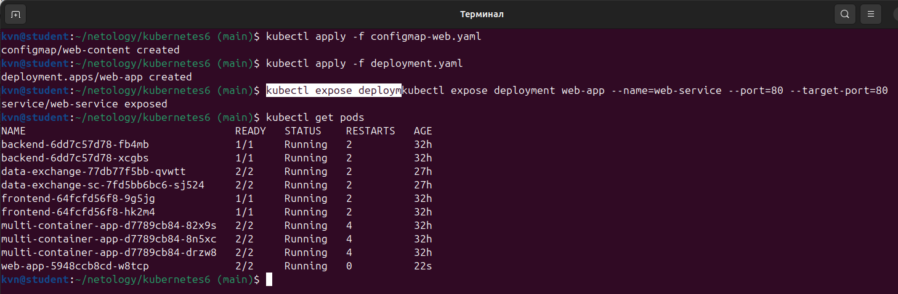
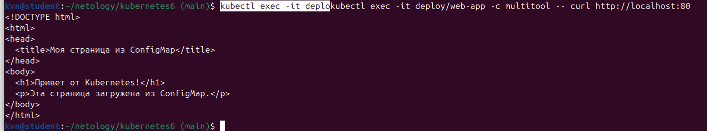
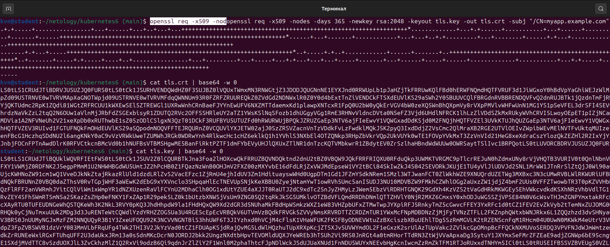
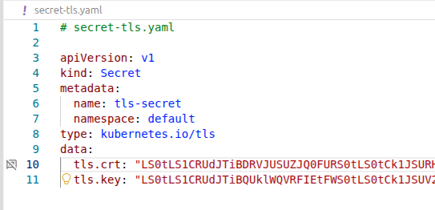
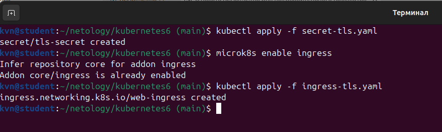
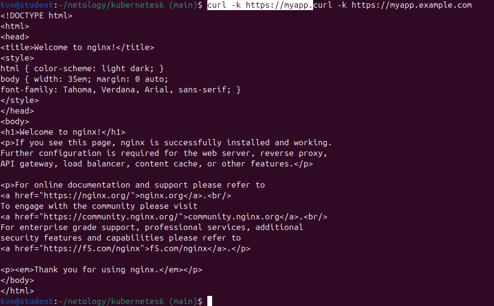
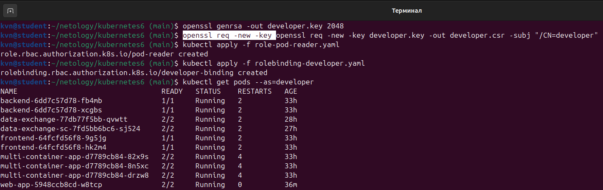
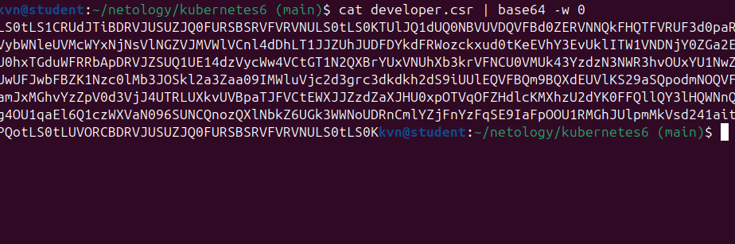
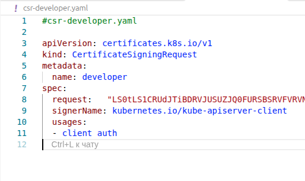
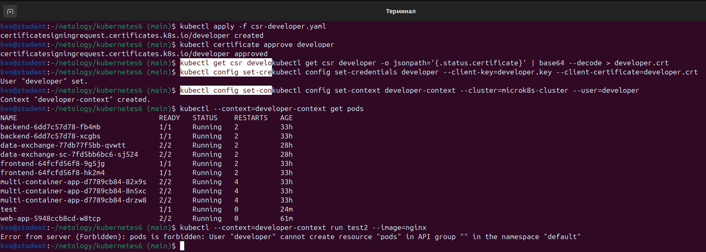

# Домашнее задание: Настройка приложений и управление доступом в Kubernetes

Настраиваем конфигурацию приложений через ConfigMaps и Secrets, управляем доступом пользователей через RBAC.

Кластер: MicroK8s.

## Файлы

| Файл | Описание |
|------|----------|
| [`configmap-web.yaml`](configmap-web.yaml) | ConfigMap с веб-страницей |
| [`deployment.yaml`](deployment.yaml) | Deployment: nginx + multitool |
| [`secret-tls.yaml`](secret-tls.yaml) | Secret для TLS-сертификата |
| [`ingress-tls.yaml`](ingress-tls.yaml) | Ingress с HTTPS |
| [`role-pod-reader.yaml`](role-pod-reader.yaml) | Role для просмотра подов |
| [`rolebinding-developer.yaml`](rolebinding-developer.yaml) | RoleBinding: developer к роли pod-reader |
| [`csr-developer.yaml`](csr-developer.yaml) | CertificateSigningRequest для пользователя developer |

---

## Задание 1. ConfigMap

Разворачиваем приложение (nginx + multitool), подключаем веб-страницу через ConfigMap.

ConfigMap содержит HTML-код страницы. Deployment монтирует его в `/usr/share/nginx/html` для обоих контейнеров.

```bash
kubectl apply -f configmap-web.yaml
kubectl apply -f deployment.yaml
kubectl expose deployment web-app --name=web-service --port=80 --target-port=80
kubectl get pods
```



Проверяем доступ к странице изнутри кластера через multitool:

```bash
kubectl exec -it deploy/web-app -c multitool -- curl http://localhost:80
```



---

## Задание 2. HTTPS + Secrets

Разворачиваем приложение с доступом по HTTPS, используем самоподписанный сертификат.

Генерируем сертификат:

```bash
openssl req -x509 -nodes -days 365 -newkey rsa:2048 \
  -keyout tls.key -out tls.crt -subj "/CN=myapp.example.com"
cat tls.crt | base64 -w 0
cat tls.key | base64 -w 0
```

Вставляем значения base64 в `secret-tls.yaml`. Не отправляем его в git.




Применяем манифесты:

```bash
kubectl apply -f secret-tls.yaml
microk8s enable ingress
kubectl apply -f ingress-tls.yaml
```



Проверяем HTTPS:

```bash
curl -k https://myapp.example.com
```



---

## Задание 3. RBAC

Создаём пользователя `developer` с правами только на просмотр подов и их логов.

**Шаг 1. Генерируем ключ и CSR**

```bash
openssl genrsa -out developer.key 2048
openssl req -new -key developer.key -out developer.csr -subj "/CN=developer"
```

**Шаг 2. Применяем Role и RoleBinding**

```bash
kubectl apply -f role-pod-reader.yaml
kubectl apply -f rolebinding-developer.yaml
```
Пользователь developer видит список подов.  


**Шаг 3. Загружаем CSR в Kubernetes через манифест**

Вставляем base64 от `developer.csr` в `csr-developer.yaml`:

```bash
cat developer.csr | base64 -w 0
```
  
  

Применяем манифест  
```
kubectl apply -f csr-developer.yaml
```

**Шаг 4. Утверждаем CSR**

```bash
kubectl certificate approve developer
```

**Шаг 5. Получаем сертификат и настраиваем контекст**

```bash
kubectl get csr developer -o jsonpath='{.status.certificate}' | base64 --decode > developer.crt
kubectl config set-credentials developer --client-key=developer.key --client-certificate=developer.crt
kubectl config set-context developer-context --cluster=microk8s-cluster --user=developer
```

**Шаг 6. Проверяем права**

```bash
kubectl --context=developer-context get pods
kubectl --context=developer-context run test2 --image=nginx
```



 Пользователь developer не может создать новый под — получает `Forbidden` потому что Role `pod-reader` даёт только права на `get`, `list`, `watch` подов, но не на `create`.
